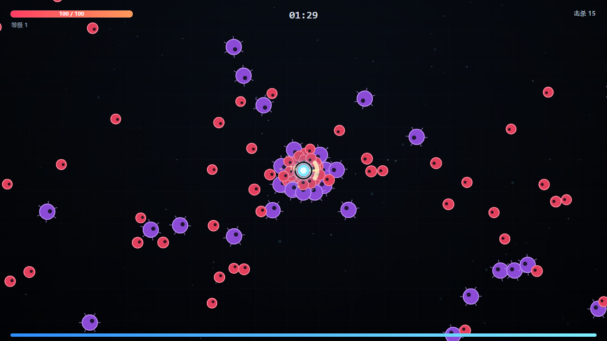
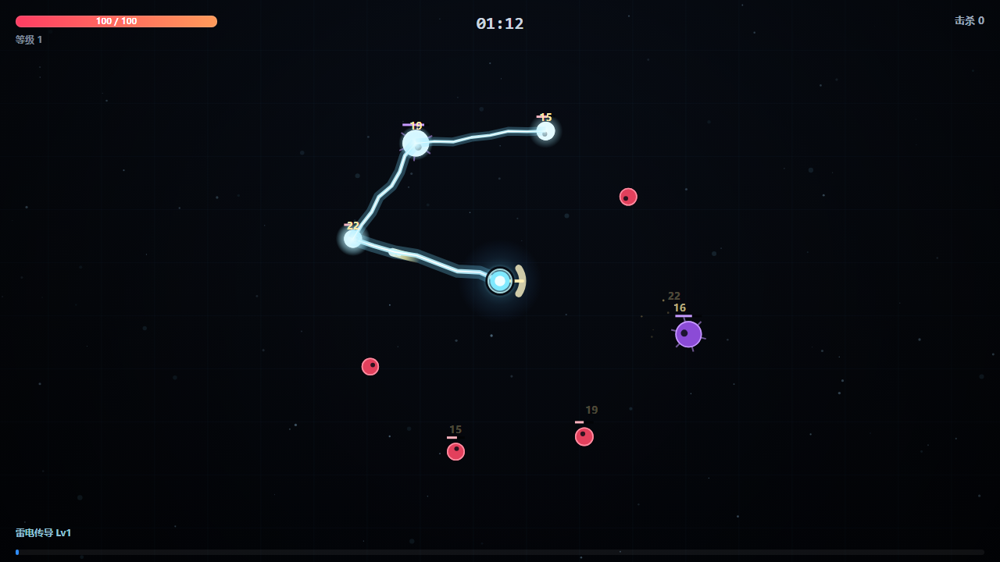
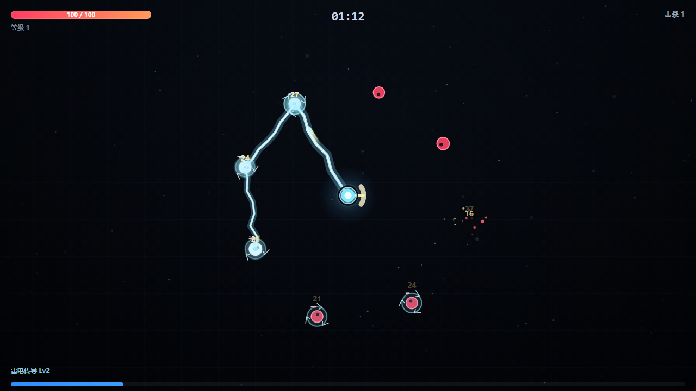
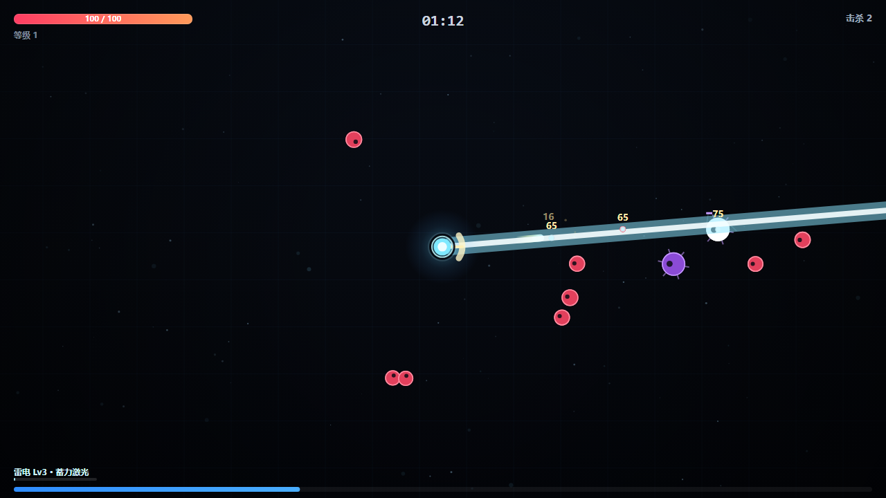
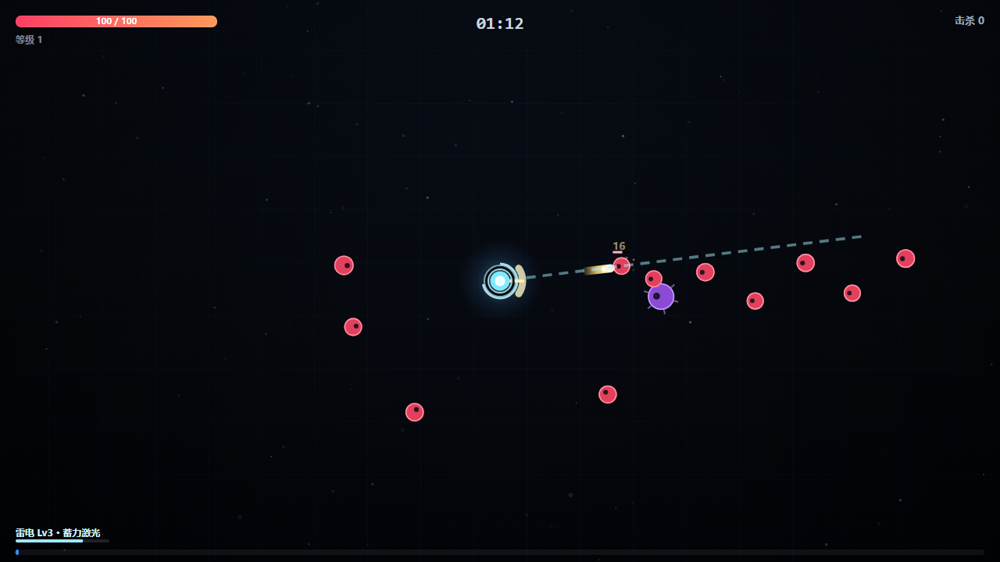
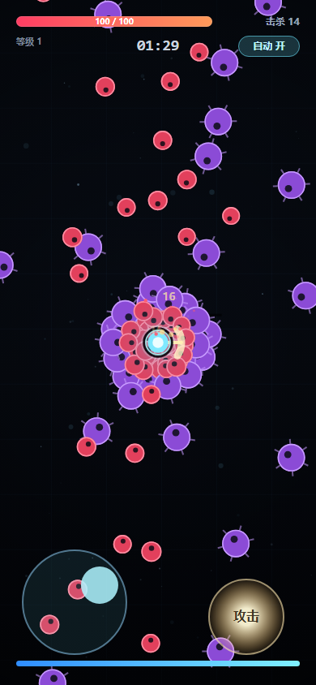
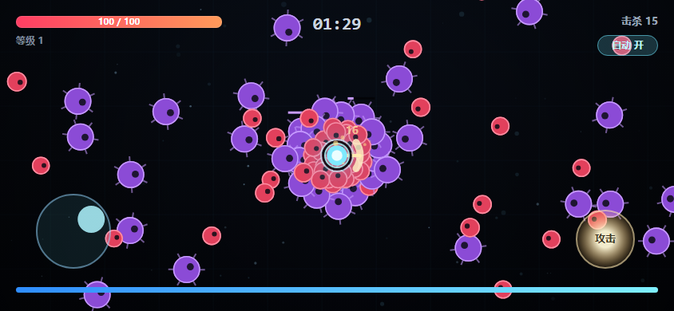

# 暗潮幸存者 · 原型

一个单文件 HTML5 幸存者-like（吸血鬼幸存者风格）小游戏，PC 键鼠和手机触屏都能玩。
**在线试玩（手机直接打开）：<https://xunxun42.github.io/survivors/>**

双击 `index.html` 即可开玩，不需要安装、不需要联网、零外部资源（音效是 WebAudio 现场合成的）。

## 操作

**电脑**

| 按键 | 动作 |
|---|---|
| `W` `A` `S` `D` / 方向键 | 移动 |
| `空格` | 攻击（自动锁定最近敌人，长按连续攻击；到雷电 Lv3 时长按 = 加速蓄力） |
| `1` `2` `3` | 升级时选择强化（也可直接点卡片） |
| `M` | 静音 |
| `R` | 死亡后重开 |

**手机 / 平板**

- **左下摇杆**：手指按在屏幕左半边任意位置就会长出摇杆，拖动移动（模拟量，推一半就是半速）。
- **右下「攻击」**：按住连续攻击。
- **右上「自动 开 / 关」**：默认开着，此时不用按攻击键也会自动出手（吸血鬼幸存者手游的惯例）；想手动就点一下关掉。
- **升级卡片**：竖排全宽，直接点。
- 触摸设备上标题文案会自动切换成触屏说明，轻触屏幕开始 / 重来。

## 技能：雷电传导

升级选项里会固定出现这个技能的下一级（Lv1 → Lv2 → Lv3，三级封顶），是**自动释放**的，不占用攻击键。

| 等级 | 效果 |
|---|---|
| **Lv1 初级雷电传导** | 每 1.5 秒自动向 430px 内最近的敌人放电，电弧再连锁到附近最多 3 个目标（每跳伤害递减 15%） |
| **Lv2 麻痹** | 命中的敌人**麻痹 1 秒**（停止移动，身上有脉冲光环 + 爬电），并**额外扣除目标 15% 最大生命** |
| **Lv3 激光** | 攻击方式改为**蓄力激光**：自然蓄满 1.05 秒，按住攻击键 0.43 秒蓄满；蓄得越满，射线越长、伤害越高 |

Lv3 数值：射程 `300 + 420 × 蓄力`（满蓄 720px），伤害 `26 + 34 × 蓄力`（满蓄 60）**再加上目标 15% 最大生命**，沿直线**贯穿**所有敌人，命中后麻痹 1.2 秒。

## 现在有什么

- **角色**：移动带惯性，受击有 0.55s 无敌帧 + 闪白 + 击退，青色本体带深色描边，怪堆里也看得清。
- **基础攻击**：自动索敌（最近 760px），发射剑气。有挥砍弧光、出剑前刺、飞行拖尾、命中火花、伤害飘字。
- **敌人**：红色小怪持续追击；45 秒后开始混入紫色带刺大怪（慢、肉、撞得疼）。有群体分离，不会叠成一坨；被麻痹时停止移动。
- **成长**：击杀掉经验，满经验触发三选一强化（8 种通用强化 + 3 级雷电技能卡）。
- **难度曲线**：刷怪间隔随时间收紧、每波数量增加、敌人血量与伤害缓慢成长，同屏上限 130 只。
- **表现**：视差星空 + 网格 + 暗角、屏幕震动、粒子、程序化音效。
- **适配**：DPR 高清渲染、窗口尺寸变化自适应、横竖屏都做了布局（短屏自动缩小摇杆/按键并抬高，避开经验条）、禁用双击缩放与滚动回弹、`env(safe-area-inset-*)` 安全区。

## 文件

```
index.html     游戏本体，全部代码在这里（原生 JS，无依赖、无构建）
README.md      这份说明
selftest.js    自测脚本：DOM 桩 + 真实游戏循环，检查连锁/麻痹/激光/升级/性能
shots/         截图（桌面 + 技能三级 + 手机横竖屏）
```

## 截图



<p align="center">
  
  
</p>
<p align="center">
  
  
</p>

<p align="center">
  
  
</p>

## 调试参数

- `index.html#demo` 或 `?demo`：直接进入一场定格好的战斗画面，方便截图/排查。
- `index.html#demo-lv2`：演示模式并直接把雷电技能设成 2 级（`lv1` / `lv3` 同理）。
- `index.html?touch=1`：在桌面上强制打开触屏控件，用来调手机布局。

## 调参位置

都在 `index.html` 里，改完刷新即可：

| 想改什么 | 找哪里 |
|---|---|
| 手感 / 移速 | `const P = { ... speed: 215 ... }` |
| 攻击力 / 攻速 / 弹道 | `function fire()` 里的 `dmg: 16`、`.26 / ST.rate`、`700 * ST.bspeed` |
| 刷怪节奏 | `update()` 里的 `spawnTick = Math.max(.22, .9 - time * .006)`、`spawnWave()` 里的 `1 + Math.floor(time / 40)` |
| 敌人强度 | `function spawnEnemy()`（`20` / `58` 血量，`7` / `14` 伤害，`hpScale = 1 + time / 95`） |
| 雷电：范围 / 连锁 / 间隔 | `SKILL_RANGE = 430`、`castChain()` 里的 `1.5`(间隔)、`200 * 200`(连锁半径)、`22`(基础伤害)、`.15`(每跳衰减) |
| 雷电：麻痹时长 / 15% 扣血 | `castChain()` 里的 `e.para = 1.0`、`dmg += e.maxHp * .15` |
| 激光：蓄力 / 射程 / 伤害 | `skillTick()` 里的 `/ 1.05`(蓄满秒数)、`2.4`(按住倍速)；`fireLaser()` 里的 `300 + 420 * SK.charge`、`26 + 34 * SK.charge`、`e.r + 12`(判定宽度) |
| 升级选项 | `const POOL = [...]` 与 `const LIGHTNING = [...]` |
| 升级曲线 | `need = Math.round(6 + level * 5.0)` |
| 手机控件大小 | `drawTouchUI()` 里的 `compact` / `jb` / `ar` / `pad` |

## 自测（`node selftest.js`）

```
PASS 连锁命中 3 个目标          PASS 伤害 = 基础 22 + 目标最大生命 15%
PASS 产生 3 段电弧              PASS 命中后进入麻痹 / 1 秒后解除
PASS 激光贯穿命中一列 5 个目标   PASS 自然蓄力约 1.05s
PASS 按住攻击键明显加快蓄力(0.43s)   PASS 满负载单步 0.28ms
```

其他实测：从 0 秒站着不动、只按攻击约 **61 秒**被打死（走位会更久）；同屏 130 敌人时单帧逻辑约 **0.28–0.42ms**（60fps 预算 16.6ms）；布局用无头 Chrome 在 390×844 / 844×390 / 1280×720 三种尺寸截图核对过。

## 下一步可以加

1. **更多技能**：把武器抽象成数组，加环绕飞刀、回旋镖、地面火圈，各自独立冷却与升级链。
2. **宝箱 / 精英怪**：掉落箱子，给一次强化或一次全屏清场。
3. **Boss**：每 2 分钟一只，血条置顶，掉特殊强化。
4. **更大的地图**：现在战场就是屏幕大小，加相机跟随会更有跑图感。
5. **元进度**：死亡后保留金币，开局选初始武器。
